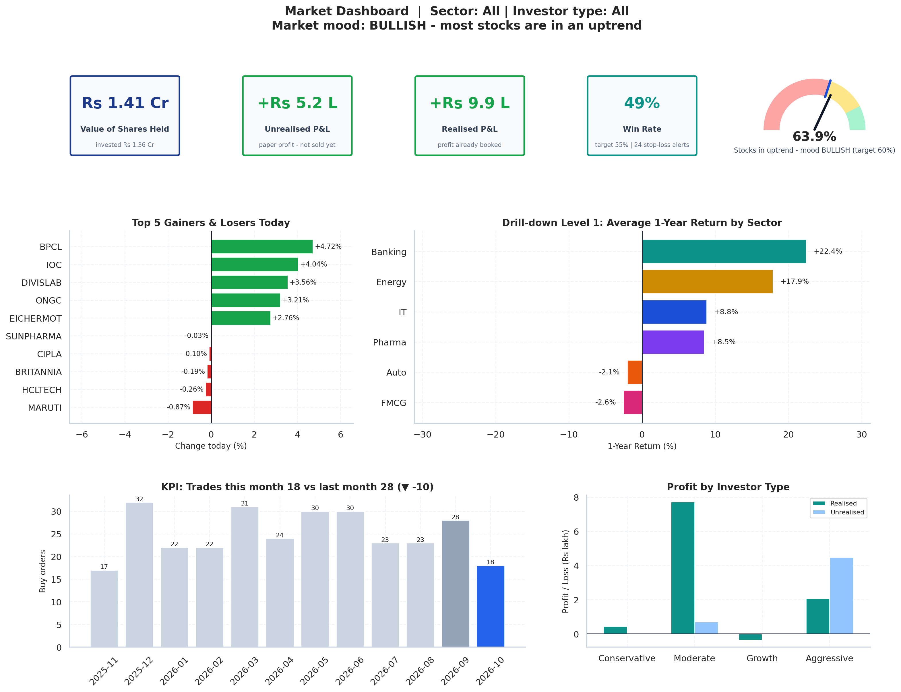
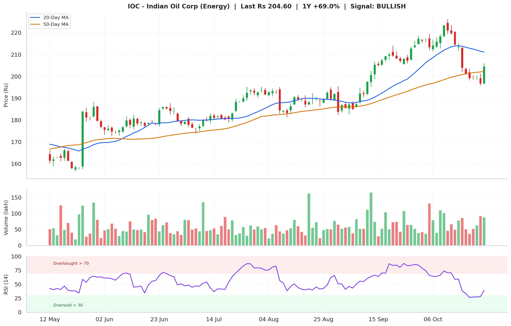

# Stock Market Analysis System (NSE, India)
### Data Visualization project · Terminal menu + MarketLens website

A Python project that analyses **36 NSE stocks** in six sectors (**IT, Banking, Pharma, Auto, FMCG, Energy**). It keeps one year of daily prices, 90 investors, their buy/sell trades, profit and loss, and the T+1 delivery of every bought share in a SQLite database. It draws **26 charts** that cover the whole Data Visualization syllabus (Unit 1 to Unit 5, the Power BI unit and the Supply Chain case study).

You can use it two ways:

| | How | What you get |
|---|---|---|
| **Terminal menu** | `python main.py` | 17 menu options. Charts are saved as PNG files in `charts/` and open in your image viewer. |
| **MarketLens website** | `python main.py --web` | Six pages in your browser at http://localhost:8000, with all 26 charts drawn and animated live. |

Both use the same database, so a stock bought on the website shows up in the terminal and the other way round.

> Prices are **simulated sample data** (a realistic random walk with market and sector moves), not real market prices. Nothing here is investment advice.

| Market dashboard (terminal image) | Stock analysis (terminal image) |
|---|---|
|  |  |

---

## Contents
1. [What you need](#1-what-you-need)
2. [Get the project](#2-get-the-project)
3. [Run on macOS](#3-run-on-macos)
4. [Run on Windows](#4-run-on-windows)
5. [Run on Linux](#5-run-on-linux)
6. [Open the website](#6-open-the-website)
7. [All commands](#7-all-commands)
8. [Main menu](#8-main-menu)
9. [Website pages](#9-website-pages)
10. [Project structure](#10-project-structure)
11. [Syllabus coverage](#11-syllabus-coverage)
12. [Troubleshooting](#12-troubleshooting)

---

## 1. What you need

- **Python 3.9 or newer** (3.10 to 3.12 recommended). Check with `python3 --version` (macOS / Linux) or `py --version` (Windows).
- **Internet once**, to install the libraries in `requirements.txt` (pandas, numpy, matplotlib, seaborn, scipy, statsmodels, squarify, scikit-learn, faker, openpyxl).
- **A web browser** (Chrome, Edge, Firefox or Safari) for the website.
- About **500 MB** of free disk space for the libraries.

The website needs **no extra package**: it runs on Python's built-in web server.

---

## 2. Get the project

**With Git:**

```bash
git clone https://github.com/thecodex110/Data-Visualisation-Project.git
```
```bash
cd Data-Visualisation-Project
```

**Without Git:** on the GitHub page click **Code → Download ZIP**, unzip it, and open a terminal inside the unzipped folder.

The database `stock_market.db` is already included. If it is ever missing, the program creates it again on first start.

---

## 3. Run on macOS

Open **Terminal** (`Cmd + Space`, type *Terminal*, press Enter) and go to the project folder (`cd` followed by the folder path; put the path in quotes if it has spaces).

**First time only:**

```bash
python3 -m venv ~/.venvs/dv-project
```
```bash
source ~/.venvs/dv-project/bin/activate
```
```bash
pip install -r requirements.txt
```

**Every time:**

```bash
source ~/.venvs/dv-project/bin/activate
```
```bash
python3 main.py
```

Notes for macOS:
- The virtual environment is created **outside** the project folder (`~/.venvs/...`). If the project sits in iCloud Drive, Desktop or Documents, macOS can block library files inside the project folder with *"library load disallowed by system policy"*.
- No `python3`? Install it from https://www.python.org/downloads/ or run `xcode-select --install`.
- Charts open in **Preview**. Chart 5 (interactive explorer) opens a live window; with Homebrew Python this needs `brew install python-tk`.

---

## 4. Run on Windows

Install Python from https://www.python.org/downloads/ and tick **"Add python.exe to PATH"** in the installer. Then open **PowerShell** (Start menu → type *PowerShell*) and go to the project folder:

```powershell
cd "C:\path\to\Data-Visualisation-Project"
```

**First time only:**

```powershell
py -m venv .venv
```
```powershell
.venv\Scripts\Activate.ps1
```
```powershell
pip install -r requirements.txt
```

**Every time:**

```powershell
.venv\Scripts\Activate.ps1
```
```powershell
python main.py
```

Notes for Windows:
- If PowerShell says *"running scripts is disabled on this system"*, allow scripts for this window only, then activate again:
  ```powershell
  Set-ExecutionPolicy -Scope Process -ExecutionPolicy RemoteSigned
  ```
- Using **Command Prompt (cmd)** instead of PowerShell? Activate with `.venv\Scripts\activate.bat`.
- `py` not found? Use `python` instead of `py`.
- Charts open in the **Photos** app (or your default image viewer).
- If symbols like ▲ █ show as `?` or you get a `UnicodeEncodeError`, run this once in the window before starting: `$env:PYTHONUTF8=1` (PowerShell) or `set PYTHONUTF8=1` (cmd).

---

## 5. Run on Linux

Ubuntu / Debian need the venv and Tk packages once:

```bash
sudo apt update && sudo apt install -y python3 python3-venv python3-pip python3-tk
```

(Fedora: `sudo dnf install python3 python3-pip python3-tkinter` · Arch: `sudo pacman -S python python-pip tk`)

Then go to the project folder.

**First time only:**

```bash
python3 -m venv .venv
```
```bash
source .venv/bin/activate
```
```bash
pip install -r requirements.txt
```

**Every time:**

```bash
source .venv/bin/activate
```
```bash
python3 main.py
```

Notes for Linux:
- Charts open with `xdg-open` in your default image viewer. On a server with no desktop, use `python3 main.py --all` to only save the PNGs, or use the website.
- `python3-tk` is only needed for the live window of chart 5.

To leave the virtual environment on any system, type `deactivate`.

---

## 6. Open the website

With the virtual environment active (see your system above), run **one** of these:

```bash
python3 main.py --web
```

or choose **17** in the main menu, or run `python3 web_app.py`. (On Windows write `python` instead of `python3`.)

Your browser opens **http://localhost:8000**. If it does not open by itself, type that address into the browser. Press **Ctrl+C** in the terminal to stop the website; if you started it from the menu, the menu comes back.

Options:
- Another port, if 8000 is busy: `python3 web_app.py --port 8080`, then open http://localhost:8080
- Don't open a browser automatically: `python3 web_app.py --no-browser`

The website uses Google Fonts when online. Offline it still works and shows your system font.

---

## 7. All commands

On Windows, use `python` where this table says `python3`.

| Command | What it does |
|---|---|
| `python3 main.py` | Interactive main menu (17 options). Only option `0` exits. |
| `python3 main.py --web` | Start the MarketLens website at http://localhost:8000 (Ctrl+C stops it) |
| `python3 main.py --all` | Save all 26 charts to `charts/` without opening windows |
| `python3 main.py --list` | List chart numbers by syllabus unit |
| `python3 main.py --chart N` | Build and show chart number N (1–26) |
| `python3 main.py --report` | Print the data cleaning & aggregation report |
| `python3 main.py --export` | Write `stock_market_export.xlsx` (6 sheets) for Power BI |
| `python3 main.py --reset-db` | Re-create `stock_market.db` with fresh sample data (your own added data is lost) |
| `python3 main.py --help` | Show all flags |

---

## 8. Main menu

| # | Option | # | Option |
|---|---|---|---|
| 1 | View Market Watchlist | 10 | Investor Portfolio & Trade History |
| 2 | Add New Stock | 11 | Data Cleaning & Aggregation Report |
| 3 | Remove / Delist Stock | 12 | Data Visualization Menu (26 charts) |
| 4 | Search & Analyse a Stock (signal + candlestick) | 13 | Generate All Charts |
| 5 | View Investor Directory | 14 | Market Dashboard (mood, cards, gauge, top movers, drill-down) |
| 6 | Add New Investor | 15 | Supply Chain Case Study: Share Delivery Tracker |
| 7 | Buy a Stock (auto 8% stop-loss, T+1 delivery) | 16 | Export Dataset for Power BI |
| 8 | Sell a Stock (auto profit/loss) | 17 | Open the Website |
| 9 | View Stop-Loss Alerts | 0 | Exit |

The menu never closes on its own: closing a chart window, an error or Ctrl+C all bring you back to the menu.

---

## 9. Website pages

| Page | Replaces menu option | What is on it |
|---|---|---|
| **Home** | – | Market mood, a 3D "ridge" of the six sector indices, index cards, top movers, sector returns |
| **Dashboard** | 1, 9, 14 | Sector and investor-type slicers, KPI cards, breadth gauge, top gainers and losers, sector → stock drill-down, watchlist with sparklines |
| **Stocks** | 4 | Search, candlestick or line chart with 20/50-day averages, volume and RSI, OHLC on hover, buy/sell signal |
| **Charts Lab** | 12, 13 | All **26 syllabus charts**, filtered by unit, with a large spotlight view and replayable animation |
| **Investors & Trade** | 5, 6, 7, 8, 9, 10 | Investor directory, portfolio and trade history, P&L of every trade, real **Buy / Sell / Add investor**, stop-loss alerts |
| **Delivery** | 15 | Animated T+1 delivery chain, region slicer, route map to NSE Mumbai, broker report card, delay reasons |

Buy and sell on the website call the same `place_buy()` / `place_sell()` functions as menu options 7 and 8 and save to `stock_market.db`.

---

## 10. Project structure

```
main.py                    # Entry point: menu, market operations, dashboard, delivery tracker, CLI flags
db_setup.py                # SQLite schema (6 tables) + simulated market data
preprocessing.py           # Cleaning, returns, P&L, technical indicators, aggregations, KPIs, deliveries
visualizations.py          # 26 matplotlib charts by syllabus unit + market dashboard + stock analysis chart
web_app.py                 # Website server (built-in http.server): pages + JSON API + buy / sell / add investor
web_data.py                # Builds the website data and the 26 charts as SVG shapes from the database
web/                       # Website: 6 HTML pages, assets/style.css, assets/app.js, js/ (one script per page)
stock_market.db            # SQLite database
stock_market_export.xlsx   # Excel export for Power BI (6 sheets)
charts/                    # Generated PNG charts
requirements.txt           # Python libraries
PROJECT_GUIDE.md           # Full explanation in Hinglish: commands, menu, syllabus mapping, viva Q&A
MENU_OPTIONS_EXPLAINED.txt # Every menu option and where its code lives
POWERBI_GUIDE.md           # Building the dashboard in Power BI Desktop
```

More detail:
- [`PROJECT_GUIDE.md`](PROJECT_GUIDE.md): the whole project explained in Hinglish, including viva questions
- [`MENU_OPTIONS_EXPLAINED.txt`](MENU_OPTIONS_EXPLAINED.txt): every menu option and the function behind it
- [`POWERBI_GUIDE.md`](POWERBI_GUIDE.md): Power BI steps

---

## 11. Syllabus coverage

| Unit | Covered by |
|---|---|
| 1. Introduction | Design principles (bad vs good chart), categorical / time-series / statistical graphics |
| 2. Pre-processing & Aesthetics | Cleaning report (missing prices forward-filled), pairplot, return heatmap, interactive explorer, graphical perception, grammar of graphics |
| 3. Visualization Design | Bar, horizontal bar, dot plot, grouped/stacked bars, histogram + KDE, violin, ECDF, Q-Q, skewed data and log transform |
| 4. Advanced Design | Box/strip vs ridgeline, pie vs bars vs stacked, parts of total, treemap / nested donut, risk-return scatter, correlogram, PCA, slope chart |
| 5. Time Series & Geospatial | Moving averages, LOESS, dose-response, multi-response, detrending, decomposition, map projections, map layers, choropleth, cartogram |
| 6. Power BI | Excel export, Market Dashboard (cards, gauge, slicers, drill-down, KPIs) in the terminal and on the website, `POWERBI_GUIDE.md` |
| Case Study | Supply chain of the stock market = share delivery (order → broker → NSE → clearing → depository → demat, T+1) |

Topic-by-topic mapping: section 8 of [`PROJECT_GUIDE.md`](PROJECT_GUIDE.md).

---

## 12. Troubleshooting

| Problem | Fix |
|---|---|
| `ModuleNotFoundError: No module named 'pandas'` | The virtual environment is not active. Activate it (see your system above), then `pip install -r requirements.txt`. |
| `python3: command not found` (macOS / Linux) | Install Python 3 (see your system above). |
| `'python' is not recognized` (Windows) | Re-run the Python installer and tick **Add python.exe to PATH**, or use `py` instead of `python`. |
| PowerShell: *running scripts is disabled* | `Set-ExecutionPolicy -Scope Process -ExecutionPolicy RemoteSigned`, then activate again. |
| macOS: *library load disallowed by system policy* | The venv is inside a protected folder. Delete it and create it in `~/.venvs/` as shown in section 3. |
| Website: *Address already in use* | Port 8000 is busy. Use `python3 web_app.py --port 8080` and open http://localhost:8080. |
| Website page says it could not load data | The server is not running. Start it again with `python3 main.py --web` and keep that terminal open. |
| Chart does not open | `--all` only saves charts. Use menu 12 or `--chart N`, or open the `charts/` folder. |
| Chart 5 live window does not open | Install Tk: `python3-tk` (Linux) or `brew install python-tk` (macOS Homebrew). |
| Excel export error | Close `stock_market_export.xlsx` if it is open in Excel, then try again. |
| Data looks wrong | `python3 main.py --reset-db` creates fresh sample data (your own added data is lost). |
